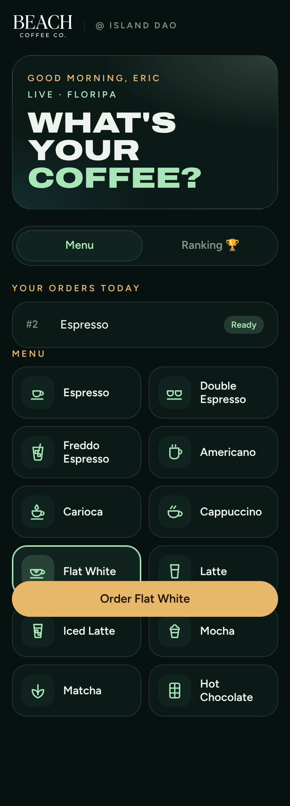
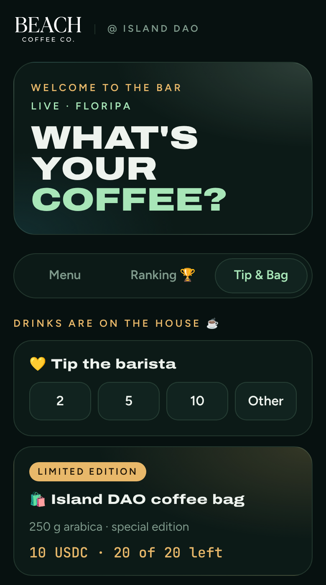
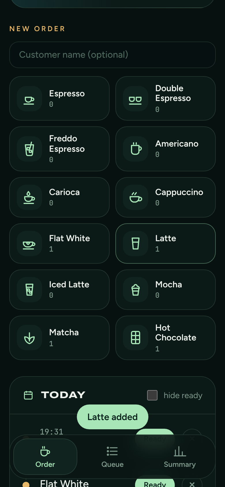

# Beach Coffee Co. · Coffee, onchain

**The coffee bar at Island DAO (Florianópolis, Oct 2026), with its own ordering and payments system, built from zero by the barista.**
IslandHack v5 · Payments + Commerce track.

- **Try it:** [@BeachCoffeeIslandBot](https://t.me/BeachCoffeeIslandBot) on Telegram (tap **Order ☕**)
- **For event organizers:** [drinkbeachcoffee.com/web3](https://drinkbeachcoffee.com/web3)
- **Pay a tip or buy the edition bag from any phone:** [drinkbeachcoffee.com/pay](https://drinkbeachcoffee.com/pay)
- **Demo video:** [`design/video/beach-coffee-demo.mp4`](design/video/beach-coffee-demo.mp4)

## The problem

A coffee bar at a builders' event: everyone wants coffee in the same break, orders get shouted and lost, nobody carries cash, and the first Solana QR we printed didn't even open in a phone camera.

## What we built

**Tap. Sip. Tip.**

1. **Order from your seat.** A Telegram Mini App: pick the drink and the milk, confirm. The order lands on the barista's panel in real time.
2. **Keep building, get pinged.** The barista taps Ready and the guest gets a Telegram message. They only walk over to pick it up.
3. **Tip in USDC, if you like.** Solflare or Phantom, confirmed onchain in seconds. The same app sells the limited **Island DAO Edition** coffee bag (20 bags, 10 USDC).

| Mini App | Tip & Bag | Barista panel |
|---|---|---|
|  |  |  |

## Traction (live, real guests)

- **2k+ coffees** served in one month at the Island DAO Vila.
- **0% → 94%** of orders through Telegram in four days (Mon 0%, Tue 18%, Wed 87%, Fri 94%).
- **~5 min → 0** in line, timed at the bar: guests wait where they work, not at the counter.
- Daily reports, a live queue and a coffee lovers ranking, straight from the bot (`/today`, `/total`).

## Payments on Solana

Every checkout (a tip or a bag) gets a unique **Solana Pay reference** key.

- **In a wallet's browser** (Solflare, Phantom), the page builds a USDC `TransferChecked` to the shop's wallet with the reference attached and asks the wallet to sign and send it. If a wallet fails at sign-and-send, the page asks it only to sign and sends the transaction itself.
- **Before the wallet opens**, the page checks the payer's USDC and SOL and says what's missing, instead of a generic wallet error.
- **If a wallet blocks the site**, a Solana Pay transfer request (`solana:` link with amount, USDC mint and reference) lets the wallet build the transfer itself.
- **The bot verifies onchain**: it looks up the reference with `getSignaturesForAddress` (every minute from a cron, every 3 s while the page is open) and accepts the payment only if the shop's USDC account received the full amount. Then it thanks the guest and pings the barista.
- **USDC sent without the reference** (from an exchange, or a plain transfer) is still caught: the cron also reads the shop's USDC account, settles the one open checkout of exactly that amount, or tells the barista it arrived.
- **Every checkout step is logged** (wallet button, wallet error, missing USDC or SOL, a transaction the network dropped), and `/payments` shows the barista where tips get stuck.
- **No custody**: the USDC goes straight to the shop's wallet. Fees are cents, so even a 1 USDC tip makes sense.

## Built for a real bar

- Hot and iced menu, milk choice (regular, lactose-free, plant-based) as a required step.
- One panel for Telegram and walk-up orders, live (Âncora, `/panel`).
- Crowd controls: pending-drink limit per guest, stock per drink, and a one-day **demo-day mode** (`/demoday`: a short menu with stock and a per-guest cap).
- Lunch break (`/lunch`), weekends closed by default, `/close` and `/open`.
- Pages that sell the bar: [`/web3`](https://drinkbeachcoffee.com/web3) for web3 organizers, [`/eventos`](https://drinkbeachcoffee.com/eventos) for weddings and private events, with an instant estimate.

## Stack

- **Cloudflare Workers + D1** (SQLite). One worker serves the Telegram webhook, the Mini App, the panel, the pay pages and the APIs. Free tier.
- **Telegram Bot API + Mini App**, with `initData` signature verification.
- **Solana**: Solana Pay references, USDC (SPL Token `TransferChecked`), public RPCs, `@solana/web3.js` bundled for the wallet page.
- **Tests:** `cd telegram-bot && npm test` (Node test runner, in-memory SQLite, faked Telegram and RPC).
- **Deploy:** GitHub Actions on every merge to `main`: tests, schema, `wrangler deploy`, health check.

## Proof of brew

Built from zero at the bar, between shifts, with AI. Not by a dev team. It ran the bar every day of the event with real guests. On the island, anyone can build.

## Repository

- [`telegram-bot/`](telegram-bot/): the worker (bot, Mini App, payments, pages) and its tests. Setup and commands in [`telegram-bot/README.md`](telegram-bot/README.md), operations in [`telegram-bot/OPERATIONS.md`](telegram-bot/OPERATIONS.md) (Portuguese).
- [`ancora/`](ancora/): Âncora, the barista panel.
- [`design/`](design/): deck, logos, stickers, social cards, demo video.
- [`docs/`](docs/): project state and pitch notes (Portuguese).
